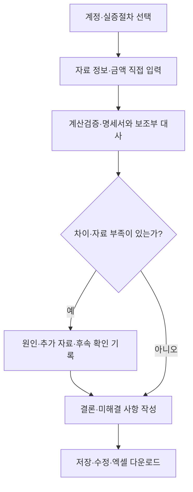
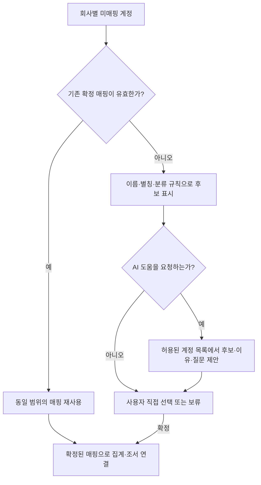

# 실증절차 안내와 감사조서 작성을 연결하는 웹 도구

> 필요한 감사자료와 확인 방법을 안내하고, 실제 수행 기록을 엑셀 조서로 정리하는 개인 프로젝트.

**진행 상태:** 기획 및 콘텐츠 설계 단계  
**현재 구현 범위:** 1단계 룰 기반 조서 작성 / 분개장·AI 매핑은 향후 확장  
**문서 기준일:** 2026-10-26

이 문서는 프로젝트의 문제의식, 목표, 구현 범위와 검증 계획을 설명한다. 아래 기능과 기술 구성은 개발 계획이며, 구현·검증이 완료된 성과를 의미하지 않는다.

## 한눈에 보는 서비스

**지금 구현할 것은 명세서·보조부·총계정원장의 금액과 근거를 직접 입력하여 실증절차 조서를 완성하는 룰 기반 웹이다.** 분개장 업로드와 AI 계정 매핑은 후속 단계로 분리한다.

| 단계 | 구현 범위 | 현재 우선순위 |
|---|---|---|
| **1단계: 조서 작성 v1** | 명세서·보조부·총계정원장 직접 입력, 안내·대사·차이 조사·저장·엑셀 출력 | **먼저 구현** |
| 2단계: 분개장 연계 | 분개장 업로드, 열 연결, 수동 계정 매핑, 확정한 매핑으로 대상 집계 | 1단계 검증 후 구현 |
| 3단계: AI 매핑 보조 | 미매핑 계정의 후보·이유·확인 질문 제안, 사용자 확정, 성능·토큰 평가 | 2단계 검증 후 구현 |

### 1단계의 사용 흐름



‘직접 입력’은 자료에서 확인한 금액·식별정보·증거 위치를 웹 입력란과 검토표에 작성한다는 뜻이다. v1은 파일에서 값을 자동 추출하지 않으며 분개장·AI·API 키 없이 사용할 수 있어야 한다.

### 단계별 기능 경계

| 기능 | 1단계 | 2단계 | 3단계 |
|---|---|---|---|
| 실증절차·주장 안내와 조서 작성 | 구현 | 유지 | 유지 |
| 명세서·보조부·총계정원장 금액 직접 입력 | 구현 | 유지 | 유지 |
| 저장·불러오기·엑셀 출력 | 구현 | 유지 | 유지 |
| 분개장 업로드·수동 계정 매핑 | 제외 | 구현 | 유지 |
| AI 계정 후보 안내·평가 | 제외 | 제외 | 구현 |

### 문서 안내

- [만들고자 하는 서비스](#만들고자-하는-서비스)
- [경영진 주장과 실증절차의 매핑](#경영진-주장과-실증절차의-매핑)
- [첫 시범 조서의 구성](#첫-시범-조서의-구성)
- [예시로 따라가는 사용 흐름](#예시로-따라가는-사용-흐름)
- [자료와 근거 관리](#자료와-근거-관리)
- [콘텐츠·기록·화면을 연결하는 상세 설계](#콘텐츠기록화면을-연결하는-상세-설계)
- [개발 단계와 검증 계획](#개발-단계와-검증-계획)
- [향후 확장 계획](#향후-확장-계획)
- [포트폴리오에서 보여줄 내용](#포트폴리오에서-보여줄-내용)

## 프로젝트를 시작한 이유

이 프로젝트는 회계법인에서 업무를 수행하며 ‘어떤 자료를 받아서 어디를 확인하고, 확인한 내용을 조서에 어떻게 남겨야 하는지 단계별로 안내받을 수 있었다면 좋았겠다’는 생각에서 출발했다.

참고할 감사절차와 조서 서식이 있더라도, 이를 실제 작업으로 옮기는 과정에서는 구체적인 질문이 남는다.

- 이 절차를 수행하려면 어떤 자료가 필요한가?
- 자료의 어느 부분을 무엇과 비교해야 하는가?
- 차이가 발생했을 때 어떤 내용을 추가로 확인해야 하는가?
- 담당자의 설명과 증거를 통해 확인한 사실은 어떻게 구분하는가?
- 수행 내용과 결과를 다른 사람이 따라갈 수 있도록 어떻게 기록하는가?

이 질문을 작성 화면 안에서 확인하고, 안내를 참고해 수행한 작업을 곧바로 기록할 수 있는 도구를 만들고자 한다. 첫 사용자는 개발자 본인으로 설정하고, 이후 감사 실무를 익히는 사용자가 활용할 수 있는지도 검토한다.

## 만들고자 하는 서비스

사용자가 계정과 실증절차를 선택하면 필요한 자료, 수행 방법, 증거 확인 지점, 기록 예시를 보여준다. 사용자는 실제 확인한 내용과 결과를 작성하고, 프로그램은 계산과 기록 정리를 지원한다. 작성 내용은 저장해 다시 수정할 수 있으며, 마지막에는 엑셀 조서로 내려받는다.

**계정·절차 선택 → 자료·금액 직접 입력 → 검토·계산 → 차이 조사 → 수행 기록·결론 → 엑셀 다운로드**

이 흐름은 작성 편의를 위한 기본 구성이다. 자료 입수를 기다리며 다른 부분을 작성하거나, 추가 확인 후 앞 단계의 내용을 수정할 수 있도록 한다.

### 첫 구현 범위

첫 시범 절차는 **현금및현금성자산·장단기금융상품 명세서의 계산검증 및 보조부 대사**다. 명세서의 행별 금액과 표시 합계, 대응하는 보조부 잔액, 총계정원장 잔액을 직접 입력하여 자료 준비부터 차이 조사·결론·출력까지 완성한다. 분개장 집계 기능은 v1의 전제로 두지 않는다.

첫 버전에서는 전체 감사업무의 수임·독립성·위험평가·통제테스트·감사의견 형성을 구현하지 않는다. 앞서 정한 감사목적·관련 위험·경영진 주장·중요성 등은 필요한 범위에서 입력하거나 다른 조서를 참조한다.

금융기관 조회, 현금 실사, 현금흐름표 검토 등은 별도 절차로 확장한다. 명세서와 장부의 금액이 일치한다는 결과를 예금의 실재성이나 미기록 계좌의 부재에 대한 결론으로 확대하지 않는다.

## 핵심 기능

아래는 **1단계에서 구현할 기능**이다.

| 기능 | 사용자의 작업 | 프로그램의 지원 |
|---|---|---|
| 계정·절차 선택 | 작성할 조서와 검토 목적을 정한다. | 사전 정의한 계정·절차·주장을 표시한다. |
| 자료·금액 직접 입력 | 명세서·보조부·총계정원장에서 확인한 금액과 위치를 작성한다. | 자료 유형·기준일·단위·범위와 입력 누락을 확인한다. |
| 자료 준비 | 필요한 자료를 요청하고 출처·버전·입수 상태를 기록한다. | 자료 목록과 입수 시 확인할 사항을 보여준다. |
| 증거 확인 | 어떤 자료의 어디를 어떻게 확인했는지 기록한다. | 시트·셀·행·페이지 등 근거 위치와 수행 결과를 연결한다. |
| 계산검증·대사 | 명세서와 장부의 금액을 입력하고 비교한다. | 합계·차이를 계산하고 미입력 항목을 표시한다. |
| 발견 사항 관리 | 차이 원인, 담당자 설명, 보강 자료와 추가 확인을 기록한다. | 조건에 맞는 후속 작성란과 남은 작업을 보여준다. |
| 수행 기록·결론 | 실제 수행한 내용과 결과, 미해결 사항을 작성한다. | 작성 예시와 기록할 항목을 제공한다. |
| 저장·출력 | 기존 업무를 다시 열어 수정하고 조서를 내려받는다. | 회사·기간별 기록을 보존하고 새 엑셀 파일을 생성한다. |

가장 중요한 기능은 ‘확인했다’는 문장만 남기는 대신 **확인 대상·수행 방법·증거 위치·결과를 연결하여 기록하는 것**이다. 예시 문장은 참고용으로 제공하며 실제로 수행하지 않은 내용을 자동으로 기록하지 않는다.

## 설계 방향

### 룰 기반 본체를 먼저 완성

1단계의 안내·입력·계산·분기·저장·출력은 사전에 정의한 콘텐츠와 규칙으로 작동한다. AI 호출·분개장 파서·계정 매핑 DB를 먼저 만들지 않고, 자료를 직접 입력하는 것만으로 하나의 조서를 끝까지 작성할 수 있게 한다.

금액 차이가 있으면 차이 원인과 추가 확인 영역을 표시하고, 자료가 미입수 상태라면 남은 작업을 기록하게 한다. 금액 차이가 없더라도 사용자가 다른 예외 사항을 추가할 수 있다.

2단계는 입력 자료를 연결하는 기능, 3단계는 계정 분류 후보를 제안하는 기능을 더한다. 후속 기능은 이미 동작하는 조서 작성 본체와 분리하여 추가한다. 기본 작성·계산·출력에서는 LLM 토큰이 발생하지 않는다. 일반적인 실행·저장 비용과는 구분한다.

처음 요구사항은 사이트 운영 중 AI API를 호출하지 않는 것이었다. 3단계에서 계정 매핑 보조에 한해 선택적 호출을 허용하도록 범위를 조정했으며, 조서의 안내·입력·계산·분기·출력과 감사판단에는 계속 AI를 사용하지 않는다.

### 절차 콘텐츠와 회사별 조서 기록 분리

재사용할 안내와 실제 업무 기록을 나누어 관리한다.

| 구분 | 관리하는 내용 |
|---|---|
| 절차 콘텐츠 | 목적, 필요 자료, 수행 방법, 기록 예시, 조건 규칙, 국내 근거와 검토 상태 |
| 조서 기록 | 회사·보고기간, 사용 자료, 검토표, 수행 내역, 발견 사항, 결론, 작성·검토 정보 |

각 조서에는 사용한 콘텐츠의 식별자와 버전을 저장한다. 안내가 수정되더라도 과거 조서의 내용이 자동으로 바뀌지 않도록 한다.

### 계정 추가 시 공통 구조 재사용

계정마다 새로운 페이지를 개발하는 대신 **공통 절차 템플릿과 계정별 설정**을 조합한다.

- 공통 템플릿: 단계 구성, 입력 유형, 표 구조, 지원하는 계산·분기 규칙, 출력 구성
- 계정별 설정: 자료명, 목적, 계정 특성에 따른 설명과 추가 항목, 관련 주장, 예시와 근거

명세서 계산검증과 보조부 대사처럼 구조가 유사한 절차부터 재사용 가능성을 확인한다. 기존에 없는 계산이나 특수한 작성 방식은 별도로 개발한다. 모든 계정을 하나의 대사표에 맞추지는 않는다.

이 구조는 계정별로 자료 전체를 다시 설명하고 코드를 반복 수정하는 부담을 줄이기 위한 것이다. 실제 개발 시간이나 토큰 절감 효과는 아직 측정하지 않았다.

### 계산과 감사판단 구분

프로그램은 수치 계산, 조건에 따른 안내, 기록 누락 표시를 담당한다. 절차의 적절성, 증거의 충분성, 발견 사항의 영향과 최종 결론은 사용자가 판단한다.

다음 상태는 별도로 관리한다.

- 절차 수행 상태
- 발견 사항의 처리 상태
- 조서 검토 상태

검사를 마쳤더라도 차이가 미해결 상태일 수 있고, 수행자가 작성을 마쳤더라도 검토가 남아 있을 수 있다. 다운로드 역시 검토 완료로 처리하지 않는다.

## 경영진 주장과 실증절차의 매핑

사용자가 계정과 절차를 선택하면 **실재성·완전성·정확성·평가·권리와 의무 등 해당 절차와 관련된 경영진 주장을 한글 명칭으로 표시**한다. 주장은 조서의 목적을 설명하고, 수행 작업·증거·결론을 연결하는 기준으로 사용한다. 구체적인 주장 목록과 적용 대상은 콘텐츠 설계에서 정리한다.

### 매핑의 기본 단위

계정에 주장 목록을 하나로 고정하는 대신 **계정 → 실증절차 → 세부 작업 → 경영진 주장**을 연결한다. 한 절차가 여러 주장에 연결될 수 있고, 하나의 주장에 여러 절차와 증거가 연결될 수 있도록 다대다 관계로 설계한다.

| 연결 | 관리할 내용 |
|---|---|
| 계정과 절차 | 해당 계정에서 선택할 수 있는 실증절차 |
| 절차와 주장 | 절차가 확인하려는 주장과 검토 목적 |
| 세부 작업과 주장 | 각 작업이 어떤 주장의 어느 범위를 다루는지 |
| 작업과 증거 | 실제 확인한 자료·위치·방법·결과 |
| 주장과 결론 | 관련 수행 결과, 사용자 결론과 미해결 사항 |

예를 들어 현금 계정에서는 명세서 대사, 금융기관 조회, 사용제한 검토를 각각 다른 절차로 구성하고, 각 절차의 목적에 맞는 주장을 연결한다. 아래는 이후 절차 확장까지 포함한 화면·데이터 설계 예시다.

| 절차·작업 | 표시할 주장·검토 목적의 예 | 연결할 기록 |
|---|---|---|
| 금융기관 조회 | 실재성·권리와 의무 등 해당 조회 목적에 맞는 주장 | 조회 대상·내용, 회신, 차이와 후속 확인 |
| 명세서와 보조부의 항목 목록 양방향 대조 | 완전성 관련 검토. 제공된 두 목록 사이의 누락·추가 항목 확인 | 비교 범위, 대상 식별값, 누락·추가 항목 |
| 명세서 재계산과 금액 대사 | 절차의 관련 주장은 완전성·평가로 표시. 세부 작업은 합계와 대응 금액의 일치 확인 | 재계산 범위, 양쪽 금액, 차이와 처리 결과 |
| 사용제한·담보제공 검토 | 권리와 의무·분류·표시 등 검토 목적에 맞는 주장 | 계약·약정 등 확인 자료와 판단 근거 |

이 표는 모든 업무에 일괄 적용할 감사판단이 아니라 매핑 구조를 설명하기 위한 예시다. 각 연결에는 확인할 범위와 적용 조건을 함께 저장한다. 명세서 대사를 마쳤다는 사실만으로 해당 계정의 실재성이나 완전성 전체를 확인했다고 표시하지 않는다.

### 시범 절차의 경영진 주장

시범 절차의 경영진 주장은 **완전성·평가(C·V)**로 유지한다. 화면과 엑셀에는 한글 명칭을 표시하고, 콘텐츠에는 주장 식별자와 근거 위치를 저장한다.

| 항목 | 내용 |
|---|---|
| 절차 | 현금및현금성자산·장단기금융상품 명세서 계산검증 및 보조부 대사 |
| 경영진 주장 | **완전성·평가(C·V)** |
| 근거 위치 | 계정별 실증절차 예시의 현금 항목 A!J17 |
| 내용 유형 | 원문 인용 (서식 표기를 그대로 사용) |
| 적용 원칙 | 기존 표기를 그대로 사용하며, 계산검증이라는 작업명만으로 정확성을 추가하거나 평가를 제외하지 않음 |

세부 작업에는 실제로 확인한 범위·증거·결과를 기록한다. 절차에 연결된 주장과 그 주장 전체에 대한 충분한 증거를 확보했다는 판단은 구분한다.

### 화면에 표시하는 방법

**절차 선택 화면**에서는 절차명 아래에 관련 경영진 주장을 한글로 표시하고, 각 주장을 선택하면 해당 절차에서 무엇을 확인하려는지 설명한다.

**수행 화면**에서는 세부 작업의 목적·관련 주장·확인할 증거를 함께 보여준다. 사용자가 수행 내용을 기록하면 해당 작업과 증거가 관련 주장에 연결된다.

**결론 화면**에서는 주장별 관련 작업·증거·발견 사항·미해결 사항을 묶어 보여준다. 사용자는 이를 확인하고 결론을 작성한다. 별도 조서에서 수행한 작업은 조서번호와 확인 범위를 참조할 수 있다.

**엑셀 출력**에도 선택한 경영진 주장과 절차별 연결을 표시한다. 조서의 목적만 보고도 무엇을 검토했는지 알 수 있게 하고, 상세 수행 기록에서 증거와 결과를 따라갈 수 있도록 한다.

### 업무별 적용과 변경

콘텐츠에는 절차별 기본 매핑을 저장하고, 개별 조서에는 해당 업무에서 적용한 주장을 저장한다. 사용자가 적용 주장을 추가·제외하거나 검토 범위를 변경하면 이유와 작성 시점을 기록한다. 이후 콘텐츠의 기본 매핑을 수정하더라도 기존 조서의 적용 내용은 자동으로 바뀌지 않는다.

주장별 화면에는 적용 여부, 연결된 수행 기록, 사용자 결론, 남은 사항을 구분해 표시한다. 한 작업의 수행 완료를 주장 전체의 검증 완료로 자동 변환하지 않는다.

### 매핑 데이터

| 데이터 | 주요 필드 |
|---|---|
| 경영진 주장 목록 | 주장 ID, 한글 명칭, 설명, 적용 대상 |
| 절차별 매핑 | 절차·세부 작업 ID, 관련 주장, 검토 목적·범위, 근거 위치·태그, 검토 상태·콘텐츠 버전 |
| 업무별 적용 | 조서 ID, 적용 주장, 관련 계획조서, 변경 이유·작성자·일시 |
| 수행 결과 연결 | 작업·증거·발견 사항 ID, 주장 ID, 사용자 결론과 미해결 사항 |

데이터 내부에서는 고정 식별자로 연결하고, 화면과 엑셀에서는 한글 명칭으로 보여준다. 알 수 없는 주장 ID, 삭제된 작업에 대한 연결, 매핑되지 않은 입력 기록은 구조 검증에서 확인한다. 매핑 내용 자체의 적절성은 별도로 검토하고 상태를 관리한다.

## 첫 시범 조서의 구성

### 작성 화면

| 단계 | 주요 작성 내용 |
|---|---|
| 목적과 범위 | 회사, 대상일, 조서번호, 계정, 목적, 검사 범위와 관련 조서 |
| 자료 준비·확인 | 명세서·보조부 등의 출처, 버전, 기준일, 입수 여부, 확인 방법과 제약 |
| 계산검증·대사 | 계좌 식별값, 명세서 금액, 보조부 금액, 근거 위치, 재계산 합계와 차이 |
| 차이·예외 조사 | 발견 사실, 담당자 설명, 보강 자료, 추가 확인과 수정 결과 |
| 수행 기록·결론 | 실제 수행 내역, 근거, 결과, 미해결 사항과 별도 검토 사항 |
| 검토·출력 | 수행자·종료일, 검토자·검토일·범위, 검토 의견, 엑셀 다운로드 |

각 단계에서 ‘왜 하는지’, ‘어떤 자료의 어디를 보는지’, ‘어떻게 확인하는지’, ‘조서에 어떻게 기록하는지’를 함께 제공한다.

### 계산과 분기

| 항목 | 처리 방식 |
|---|---|
| 행별 차이 | 명세서 금액 − 보조부 금액 |
| 명세서 계산검증 | 명세서 표시 합계 − 행별 재계산 합계 |
| 장부 연결 | 보조부 합계 − 해당 계정 총계정원장 잔액 |
| 금액 미입력 | 0원으로 처리하지 않고 계산 불가 또는 미입력으로 표시 |
| 차이 발생 | 원인·추가 자료·후속 확인·처리 결과 영역 표시 |
| 수정 자료 입수 | 원본과 연결한 새 버전으로 기록하고 재검사 결과 보존 |

원본 표시 합계, 재계산 합계, 수정본 금액을 구분한다. 명세서의 합계 오류와 개별 항목의 장부 차이가 함께 발생하면 각각 기록한다.

### 결론 화면: 대사 결과와 재무제표 연결 기록

결론에는 **명세서·보조부·총계정원장 사이의 실제 대사 결과**를 남긴다. 또한 감사기준서 330 문단 30의 재무제표 정보와 기초 회계기록의 일치·조정 문서화에 연결할 수 있도록 다음 항목을 둔다.

| 항목 | 기록 내용 |
|---|---|
| 이번 조서의 대사 결과 | 명세서 계산검증 결과, 명세서와 보조부의 차이, 보조부와 총계정원장의 차이, 조정·재확인 내용 |
| 재무제표 정보와 회계기록의 연결 | 일치 확인 / 조정 후 확인 / 확인 중 / 별도 조서 참조·미수행 상태와 실제 수행 범위 |
| 연결 근거 | 관련 재무제표 항목, 대응 회계기록, 조정 내역, 근거 위치 또는 수행한 조서번호 |
| 명시 문장 | 어떤 재무제표 정보가 어떤 회계기록과 일치 또는 조정되었는지, 근거와 범위를 포함한 사용자 작성 문장 |

이번 v1은 재무제표 대사 전체를 필수 수행하는 모듈이 아니다. **명세서·보조부·총계정원장이 일치해도 재무제표 정보의 연결까지 수행했다고 자동 기재하지 않는다.** 별도 조서에서 확인했다면 참조를 남기고, 실제 수행하지 않았다면 미수행·미연결 상태를 결론과 출력에 유지한다. 시산표를 재무제표 자체로 대체하지 않는다.

실제로 연결 검토를 수행했을 때 사용할 문장 틀은 다음과 같다.

> [재무제표 항목·범위]를 [회계기록·근거 위치]와 대사하여 [일치 / 조정 내역]을 확인하였다. 관련 수행 기록은 [이 조서의 작업 또는 참조 조서번호]에 기재하였다.

단순 체크박스로 이 문장을 완성하지 않으며, 수행하지 않은 경우에는 해당 문장을 자동 삽입하지 않는다.

### 엑셀 결과물

기존 서식의 셀을 채우는 방식이 아니라, 웹에 저장한 기록으로 새로운 `.xlsx` 조서를 생성한다.

출력 순서는 **기본정보 → 목적·범위 → 사용 자료 → 수행 내역·검토표 → 발견 사항·후속 대응 → 결론·미해결 사항 → 작성·검토 기록**으로 설계한다.

간단한 조서는 한 시트에서 읽을 수 있게 하고, 상세표가 길면 별도 시트로 연결한다. 결론 영역에는 330.30 관련 재무제표 연결의 수행 상태·명시 문장·근거 또는 별도 조서 참조도 출력한다. 미해결·미검토 상태와 원본·수정본 구분을 출력에서도 유지한다. 증거 파일을 함께 제공하지 않는 경우에는 자료의 식별정보와 위치만 포함된다는 점을 표시한다.

## 예시로 따라가는 사용 흐름

다음은 **1단계의 직접 입력 사례**다. 회사·자료·계좌·금액·수행 사실은 전부 가상이다. 분개장으로 재계산한 잔액을 보조부라고 부르거나, 보조부 입력값 대신 사용하지 않는다.

### 예시 1. 명세서·보조부·총계정원장 직접 입력

대상일은 2025-12-31, 통화·단위는 KRW·원으로 가정한다.

| 자료 | 사용자가 입력할 값 | 가상 근거 위치 |
|---|---|---|
| 명세서 원본 | K01 12,400,000 / K02 8,000,000 / 표시 합계 20,500,000 | 명세_v1, 명세!E4:E6 |
| 보조부 | K01 12,500,000 / K02 8,000,000 | 보조부, 잔액!D4:D5 |
| 총계정원장 | 해당 계정 잔액 20,500,000 | 총계정원장, 원장!D4 |

파일명·시트·셀은 화면과 기록 연결을 보여주기 위한 가상 위치다. 이 문서에 실제 증거 파일이 첨부되어 있다는 뜻이 아니다. 사용자는 각 자료의 출처·입수일·버전·기준일과 확인한 범위를 함께 기록한다.

### 예시 2. 계산검증과 장부 연결

| 검사 | 계산 | 결과 |
|---|---|---|
| 명세서 재계산 | 12,400,000 + 8,000,000 | **20,400,000원** |
| 명세서 합계 오류 | 표시 합계 20,500,000 − 재계산 합계 20,400,000 | **+100,000원** |
| 보조부 합계 | 12,500,000 + 8,000,000 | **20,500,000원** |
| 보조부와 총계정원장 | 20,500,000 − 20,500,000 | **0원** |

명세서 표시 합계와 총계정원장이 우연히 같더라도 행별 금액이 정확하다는 뜻은 아니다. 합계 계산 오류와 개별 계좌 차이는 분리해서 표시한다.

### 예시 3. 명세서와 보조부 대사

| 계좌 | 명세서 금액 | 보조부 금액 | 차이: 명세서 − 보조부 | 처리 상태 |
|---|---:|---:|---:|---|
| K01 | 12,400,000 | 12,500,000 | **-100,000** | 원인 확인 중 |
| K02 | 8,000,000 | 8,000,000 | 0 | 금액 차이 없음 |
| 재계산 합계 | 20,400,000 | 20,500,000 | **-100,000** | K01 관련 추가 확인 필요 |

K01 차이는 명세서 - 보조부 비교에서 발견한 차이다. 분개장 집계액이나 감사인의 별도 재계산 잔액을 보조부 금액으로 사용하지 않았다. 관련 근거는 명세_v1의 K01 행과 보조부의 K01 행으로 각각 연결한다.

주장별 패널은 다음과 같이 표시할 수 있다.

| 적용 주장·목적 | 연결한 작업 | 결과 |
|---|---|---|
| 완전성·평가 | 명세서 재계산과 명세서·보조부 금액 대사 | 합계 오류 +100,000원, K01 차이 -100,000원 |
| 완전성 | 제공된 명세서와 보조부의 목록 양방향 대조 | 가상 K01·K02 목록 사이의 누락·추가 여부와 수행 방법을 별도로 기록 |

시범 절차의 주장 표시는 완전성·평가로 유지한다. 금액 대사만으로 관련 주장 전체의 결론을 자동 생성하지 않는다. 실재성 등 별도 목적의 절차는 해당 조서를 연결한다. 목록이 같다는 사실만으로 실제 모든 계좌의 완전성을 확인했다고 기록하지 않는다.

### 예시 4. 수행 기록·미해결 결론·엑셀

**가상 수행 기록**

> 원본 명세서의 K01·K02 금액을 재계산한 결과 20,400,000원으로 표시 합계 20,500,000원과 +100,000원 차이가 발생하였다. 명세서와 보조부를 계좌별로 대사한 결과 K01에서 -100,000원 차이를 확인하였다. 보조부 합계는 20,500,000원으로 총계정원장 잔액과 일치하였다. 명세서 합계 오류와 K01 차이의 원인 확인 자료를 요청했으며, 현재 추가 자료는 미입수 상태다.

**가상 결론**

> 제공된 자료 범위에서 보조부 합계와 총계정원장 잔액은 일치한다. 명세서 계산검증 및 명세서·보조부 대사에서 발견한 두 차이는 원인 확인 중이며 미해결 상태다. 재무제표 정보와 기초 회계기록의 일치·조정에 관한 별도 연결 검토는 이번 사례에서 수행하지 않았고, 참조 조서도 아직 연결하지 않았다.

**추가 자료를 받아 차이를 해소한 경우의 연습 경로**

수정 명세서 K01이 12,500,000원이고 K02가 8,000,000원, 표시 합계가 20,500,000원으로 수정되었다고 가정한다. 12,500,000 + 8,000,000 = 20,500,000원으로 재계산하고, 각 계좌를 보조부와 다시 대사하여 차이 0원을 기록한다. 원인과 수정 근거를 확인한 기록을 함께 남기며, 수정본 금액만 맞는다는 이유로 처리 완료로 바꾸지 않는다. 재무제표 연결은 여전히 별도 수행·참조가 필요한 상태로 유지한다.

| 엑셀 영역 | 출력 내용 |
|---|---|
| 대상·목적 | 계정, 절차, 완전성·평가와 검토 범위 |
| 자료·금액 | 명세서·보조부 금액, 원본·수정본, 총계정원장 연결 |
| 발견 사항 | 합계 오류와 계좌 차이 각각의 원인·근거·후속 확인 |
| 결론 | 이번 대사 결과, 미해결 사항, 재무제표 연결 상태·문장·참조 |
| 추적 정보 | 콘텐츠 버전, 경영진 주장 적용 기록, 조서 리비전 |

## 자료와 근거 관리

절차 콘텐츠는 한국 회계감사기준과 국내 실무자료를 바탕으로 정리한다. 사용자에게 필요한 목적·수행 방법·기록 항목을 중심으로 구성하고, 엑셀 출력 형식은 별도로 설계한다.

안내에는 다음 구분을 적용한다.

| 구분 | 관리 원칙 |
|---|---|
| 원문 인용 | 인용 범위와 출처를 표시한다. |
| 근거 요약 | 관련 문단·페이지·서식 위치와 연결하고 원문 자체와 구분한다. |
| 보완 설명 | 구체적인 수행 방법을 제안한 내용으로 표시하고 적용 조건을 검토한다. |
| 가상 예시 | 실제 감사 수행 사실과 구별한다. |
| **미확인** | 근거가 부족하거나 원문·적용 범위·전문 내용의 검토가 끝나지 않은 내용임을 표시한다. |

‘미확인’은 다른 내용 유형과 함께 표시할 수 있다. 예를 들어 ‘보완 설명·미확인’으로 표시하고, 검토자·일자·검토범위·의견을 별도 필드로 남긴다. 문장을 작성했다는 사실과 그 근거를 검토했다는 사실을 구별한다.

자료의 발행일과 시행일·적용 보고기간을 구분하고, 콘텐츠의 검토 상태와 버전을 기록한다. 자료를 추출했거나 AI가 설명을 작성한 것만으로 실무 검토가 완료됐다고 표시하지 않는다.

기준의 구체적인 문단 매핑은 콘텐츠 검토 자료에서 관리한다. 이 기획서는 감사기준 준수를 보장하는 문서가 아니다. GitHub에 공개하는 자료는 이용조건을 확인하고, 원문 전체나 실제 회사의 감사자료를 포함하지 않는 방향으로 구성한다. 데모와 검증에는 가상 자료를 사용한다.

## 구현 구상

첫 버전은 로컬에서 실행하는 단일 사용자 웹 프로그램으로 시작한다. 아래는 **1단계 구현 구성**이며, 분개장 파서·계정 매핑·LLM 어댑터는 포함하지 않는다. 실제 개발 환경에 맞춰 확정한다.

| 영역 | 제안 구성 | 담당 기능 |
|---|---|---|
| 웹 서버 | Python·FastAPI | 화면 데이터 제공, 기록 저장, 계산과 출력 요청 처리 |
| 화면 | HTML·CSS·JavaScript | 설정에 따른 안내·입력란·검토표 구성 |
| 콘텐츠 | JSON | 공통 템플릿, 계정별 설정, 출처와 버전 |
| 업무 기록 | SQLite | 1단계: 회사·감사건·조서·입력 금액·증거·주장 적용·수정 이력 |
| 계산 | 공통 계산 모듈 | 입력 검증과 사전 정의한 계산·분기 |
| 엑셀 출력 | Python 기반 생성 모듈 | 조서 레이아웃과 수식 생성 |

콘텐츠에는 프로그램이 지원하는 규칙만 지정할 수 있게 하고, 임의의 문자열을 코드로 실행하지 않는다. 금액은 정수 또는 고정 소수점 방식으로 처리하고, 엑셀 수식과 프로그램 계산의 일치 여부를 확인한다.

외부 배포와 다중 사용자 기능은 첫 버전의 사용 흐름을 검증한 뒤 접근권한·보관·백업 방식과 함께 설계한다.

## 콘텐츠·기록·화면을 연결하는 상세 설계

### 콘텐츠 파일의 역할

콘텐츠는 설명문만 모아두는 대신, 공통 화면이 읽을 수 있는 설정으로 관리한다.

| 구성 | 포함할 내용 |
|---|---|
| 출처 목록 | 발행기관·자료명·판본·공식 위치·발행일·적용 시점·사용 범위 |
| 주장 목록과 매핑 | 한글 명칭·설명·적용 대상, 절차·작업별 연결, 검토 근거 |
| 절차 템플릿 | 기본 단계, 안내 배치, 입력 유형, 표 구성, 지원 계산·분기, 출력 구성 |
| 계정별 설정 | 템플릿 선택, 계정·자료 명칭, 목적·주장 연결, 추가 필드·안내·예시 |
| 검토 메타데이터 | 콘텐츠 버전, 작성·검토 상태, 검토자·일시·범위·변경 내역 |

초기 파일 구조는 다음과 같이 제안한다. 경로와 식별자는 구현 과정에서 확정한다.

```text
content/
  sources.json
  assertions.json
  assertion_mappings.json
  templates/
    schedule_recon.json
  bindings/
    cash.schedule_recon.json
```

안내의 각 항목은 내용 유형, 출처 참조, 검토 상태를 갖는다. 여러 문장을 서로 다른 근거에서 정리한 경우에는 문단 전체에 출처 하나만 붙이기보다 필요한 단위로 연결한다. 초안·미확인 안내를 배포할지 여부와 표시 방식도 콘텐츠 상태에 따라 통제한다.

### 공통 템플릿의 예

`schedule_recon` 템플릿에는 자료 준비, 자료 적합성 확인, 계산검증, 대사, 발견 사항, 결론 작성 화면을 둔다. `cash.schedule_recon` 설정에는 현금 계정의 자료명·계좌 식별 열·관련 주장 연결·기록 예시를 지정한다.

지원할 입력 유형은 단문·장문·날짜·숫자·선택값·표·증거 참조·관련 조서 참조다. 계산·분기는 코드에서 제공하는 식별자로만 연결한다. 콘텐츠를 추가했을 때 알 수 없는 입력 유형이나 계산 규칙이 있으면 적용 전에 오류를 표시한다.

같은 구조로 다른 계정을 추가할 때는 설정 데이터의 추가만으로 안내·입력·출력이 가능한지 확인한다. 다른 표 구조나 계산이 필요하면 템플릿이나 기능을 확장하고, 기존 조서에 미치는 영향을 검증한다.

### 업무 데이터 모델

다음은 1단계에 필요한 기록이다. 분개장 라인·계정 매핑·AI 제안 기록은 후속 단계에서 추가한다.

| 저장 단위 | 핵심 기록 | 연결 관계 |
|---|---|---|
| 회사 | 회사 식별자·표시명 | 여러 감사건 보유 |
| 감사건 | 보고기간·통화·단위·참조 정보 | 여러 조서 보유 |
| 조서 | 번호·제목·목적·범위·콘텐츠 버전·주장 적용 기록 | 주장 적용·작업·증거·결론 연결 |
| 자료 | 자료명·출처·입수일·기준일·원본/수정본·위치 | 원본과 수정본의 관계 유지 |
| 작업 기록 | 세부 작업·대상·방법·결과·수행자·일자 | 관련 주장과 증거 연결 |
| 증거 확인 | 자료 위치·확인 범위·수행 방법·결과·제약 | 자료 등록과 별도 관리 |
| 검토표 행 | 대상 식별값·입력값·수정값·계산 결과 | 증거 위치·발견 사항 연결 |
| 발견 사항 | 사실·원인·담당자 설명·후속 확인·처리 상태 | 관련 작업·증거·평가 기록 연결 |
| 결론·재무제표 연결 | 대사 결론, 미해결 사항, 330.30 관련 연결 상태·명시 문장·근거·참조 조서 | 수행 결과와 실제 확인 범위 연결 |
| 검토 기록 | 검토자·일자·범위·의견·답변 | 조서 또는 특정 작업에 연결 |
| 리비전 | 저장 시점·수정 내용·작성자 | 수정 전후 기록 추적 |

엑셀에 나타나는 행 번호와 내부 기록 식별자는 구분한다. 행을 정렬하거나 삽입해도 근거와 발견 사항이 다른 항목으로 연결되지 않도록 고정 식별자를 사용한다.

### 입력 검증과 상태 규칙

| 상황 | 프로그램 처리 | 자동으로 판단하지 않을 것 |
|---|---|---|
| 비교 금액 한쪽이 빈칸 | 차이 계산 보류, 미입력 안내 | 차이가 0이라고 처리하지 않음 |
| 금액 차이 있음 | 발견 사항 추가와 원인·후속 확인 안내 | 자동 수정분개·왜곡표시 확정 |
| 차이는 0이나 별도 예외 있음 | 수동 발견 사항 등록 지원 | 차이 0을 이상 없음으로 확정 |
| 담당자 설명만 입력 | 설명과 미입수 보강 자료를 구분 표시 | 설명 입력만으로 해소 처리 |
| 수정본 등록 | 별도 버전과 재검사 기록 생성 | 원본 삭제·기존 차이 은폐 |
| 해당 없음 선택 | 적용하지 않는 사유 기록 | 감사기준 요구사항 이탈로 일괄 분류 |
| 다른 절차로 대응 | 절차·조서 참조와 결과 기록 | 관련 주장의 충족 여부 자동 확정 |
| 검토 정보 미입력 | 미검토로 표시하고 초안 다운로드 허용 | 수행자가 기록한 이름을 실제 검토로 인정 |

절차 수행 상태는 `미착수 / 진행 중 / 수행 완료 / 해당 없음 / 대체절차 수행`, 발견 사항 처리는 `미해결 / 후속 확인 중 / 처리 완료`, 검토는 `미검토 / 검토 중 / 의견 처리 중 / 검토 완료`로 제안한다. 실제 구현에서는 입력값을 갖추었는지 확인하는 규칙과 사용자의 완료 표시를 구분한다.

`해당 없음`(적용 조건이 없어 수행하지 않음)과 `대체절차 수행`(절차의 목적을 다른 절차로 달성함)을 구분한다. 대체절차 수행을 선택하면 수행한 대체절차, 그 절차가 목적을 어떻게 달성했는지, 이탈 이유를 기록한다(감사기준서 230 문단 12).

발견 사항을 처리 완료로 표시할 때는 처리 내용과 근거를 기록하게 한다. 프로그램의 필수 입력 검사는 기록 누락을 줄이기 위한 기능이며, 전문적 판단의 타당성을 보장하지 않는다.

### 저장·버전·출력 정책

사용자가 저장하면 조서 리비전을 남긴다. 최초 적용한 콘텐츠 버전은 유지하며, 새 버전으로 변경하려면 변경 내용과 기존 입력값의 호환 여부를 확인하고 명시적으로 적용한다.

엑셀에는 해당 출력이 어떤 조서 리비전과 콘텐츠 버전에서 만들어졌는지 기록한다. 기본 출력은 선택한 시점의 기록을 사용하고, 내부 저장 이력을 모두 본문에 나열하지 않는다. 원본과 수정본의 차이, 후속 확인 결과처럼 결론을 이해하는 데 필요한 기록은 출력에 포함한다.

조서의 편집 잠금은 업무상 기능으로 설계한다. 이를 최종 감사파일 취합이나 법정 보존 기능과 동일하게 취급하지 않는다. 후자의 기능은 추후 적용 요건을 검토한 뒤 추가한다.

### 설정의 확장 범위

첫 버전은 단일 사용자의 기본 설정만 제공한다. 이후 법인별 방법론이나 감사건별 기준이 필요해지면 공통 기본값과 변경값, 변경 이유를 추적할 수 있도록 확장한다. 허용오차·중요성·대상 선정 기준은 임의의 숫자를 기본값으로 확정하지 않는다.

실제 자료와 다른 기간·통화·단위·계정 범위를 비교할 때는 경고와 연결 내역을 제공한다. 시산표와 총계정원장의 연결 확인, 재무제표 표시금액과 회계기록의 연결 확인은 서로 다른 작업으로 기록한다.

## 개발 단계와 검증 계획

### 1단계 구현 순서

v1 완료 전에는 분개장 업로드와 AI 추천을 구현 선행 조건으로 두지 않는다.

| 단계 | 작업 | 확인할 결과 |
|---|---|---|
| 콘텐츠 설계 | 시범 절차의 안내·예시·출처·미확인 사항 정리 | 필요한 자료와 수행·기록 방법이 연결되는가 |
| 공통 구조 설계 | 콘텐츠 형식과 업무 기록 모델 정의 | 계정별 내용과 공통 기능이 분리되는가 |
| 자료·금액 입력 | 명세서·보조부·총계정원장의 금액과 근거 위치 직접 입력 | 자료 간 비교 범위와 원본·수정본이 구분되는가 |
| 핵심 기능 구현 | 작성·계산·분기·저장·재조회 구현 | 입력과 기록이 일관되게 유지되는가 |
| 출력 구현 | 엑셀 생성과 레이아웃 작성 | 웹 기록과 출력 결과가 일치하는가 |
| 사례 검증 | 정상·차이 발생·자료 부족 사례 실행 | 상황별 결과와 남은 작업이 정확하게 표시되는가 |
| v1 완료 확인 | 직접 입력 → 대사 → 차이 조사 → 저장·재조회 → 엑셀 | 분개장·AI 없이 정상·차이·자료 부족 사례를 끝까지 작성할 수 있는가 |

### 1단계 가상 사례·검증

가상 사례에서는 다음을 확인한다.

- 빈칸과 0원 구분, 입력 수정에 따른 계산 갱신
- 합계 오류와 행별 차이의 분리
- 담당자 설명과 자료 재확인의 구분
- 원본·수정본과 근거 위치의 연결
- 미입수 자료·미해결 사항·미검토 상태의 유지
- 회사·보고기간별 기록 분리와 저장 후 재조회
- 엑셀의 값·수식·서술 내용 및 출력 가독성

경영진 주장과 콘텐츠 설정에는 별도 검증 사례를 둔다.

| 검증 사례 | 기대 결과 |
|---|---|
| 절차 선택 | 연결된 경영진 주장이 한글 명칭으로 표시되고, 선택한 주장별 검토 목적을 볼 수 있다. |
| 시범 절차의 기본 주장 | 콘텐츠 기본값인 완전성·평가(C·V)가 화면·엑셀·콘텐츠에 일관되게 표시된다. 업무별로 주장을 추가·제외하면 변경 이유와 함께 해당 조서의 적용 기록에만 반영되고 콘텐츠 기본값은 바뀌지 않는다. |
| 미확인 콘텐츠 | 내용 유형과 미확인 상태가 함께 표시되며 검토 완료로 오인되지 않는다. |
| 330.30 관련 결론 | 명세서·장부 대사 결과와 재무제표 연결 상태를 구분하고 실제 수행·참조 없이 일치 확인 문장을 만들지 않는다. |
| 시범 대사 예시 | 명세서 − 보조부, 보조부 합계 − 총계정원장을 비교하고 분개장 재계산액을 보조부로 사용하지 않는다. |
| 한 절차가 여러 주장에 연결 | 주장별 목적·범위·증거·결론을 구별하여 저장한다. |
| 업무별 주장을 변경 | 콘텐츠의 기본 매핑은 유지하고 해당 조서의 적용 내용·변경 이유·버전을 기록한다. |
| 하나의 연결 작업만 완료 | 관련 주장 전체를 자동으로 검증 완료 처리하지 않는다. |
| 관련 근거는 다른 조서에 존재 | 참조 조서와 확인 범위를 기록할 수 있다. |
| 콘텐츠에 새 버전 등록 | 기존 조서가 자동으로 변경되지 않는다. |
| 검토표 정렬·행 삽입 | 증거와 발견 사항이 고정 식별자를 통해 같은 항목에 연결된다. |
| 미검토 매핑 또는 알 수 없는 주장·규칙 | 콘텐츠 검증 결과에 표시하고 묵시적으로 적용하지 않는다. |
| 엑셀 출력 | 선택한 경영진 주장과 절차별 연결이 한글로 표시되고, 수행 기록·증거와 연결된다. |

포트폴리오에는 정상 입력의 화면뿐 아니라, 위 경계 사례를 어떻게 처리했는지 보여주는 가상 데이터와 결과도 포함할 계획이다.

기능 검증과 전문 콘텐츠 검토는 따로 기록한다. 프로그램이 정상 동작한다는 결과만으로 안내 내용의 적절성이 검증됐다고 보고하지 않는다.

## 향후 확장 계획

아래는 **v1 범위 밖**의 계획이다. 1단계 조서 작성이 정상 작동한 뒤 순차적으로 진행한다.

| 단계 | 새로 추가할 기능 | 선행 조건 |
|---|---|---|
| 2단계 | 분개장 업로드·열 매핑·입력 검증·수동 계정 매핑·원본 라인 추적 | 직접 입력 조서의 저장·계산·출력 검증 완료 |
| 3단계 | AI 계정 후보·이유·확인 질문, 사용자 확정, 비용·성능 평가 | 수동 매핑과 수정·재사용·집계가 검증됨 |

후속 단계에서 공통 계정 목록, 원본 분개 라인, 회사별 확정 계정 매핑을 추가하고, 3단계에서는 AI 제안·모델·토큰·사용자 확정 기록을 분리해 저장한다. AI 키는 서버에서 관리하며 분개장 전체를 기본 전송 대상으로 두지 않는다.

### 2·3단계 상세 구상: 분개장 입력과 계정 매핑

#### ‘계정 매핑’과 ‘경영진 주장 매핑’ 구분

분개장의 회사 계정명을 프로그램의 공통 계정에 연결하는 작업과, 실증절차를 경영진 주장에 연결하는 작업은 구분한다.

| 매핑 | 예시 | 결정하는 것 |
|---|---|---|
| 계정 매핑 | 회사 계정 ‘보통예금_운영’ → 앱 공통 계정 ‘보통예금’ → ‘현금및현금성자산’ 조서 그룹 후보 | 어떤 거래와 계정을 어떤 조서에서 다룰지 |
| 경영진 주장 매핑 | 선택한 실증절차·작업 → 실재성·완전성 등 관련 주장 | 그 절차가 무엇을 확인하려는지 |

계정 매핑은 조서의 검토 대상을 연결하는 단계다. 계정명만으로 필요한 감사절차나 경영진 주장을 모두 확정하지 않는다.

#### 1. 분개장 입력과 자료 구조 확인

분개장 파일을 불러오면 원본 열과 프로그램의 입력 항목을 연결한다. 2단계에서는 한 행에 계정과 차변·대변이 기록된 분개 라인 형식을 우선 지원하고, 다른 형식은 변환 방법을 안내한다.

| 원본 열 이름의 예 | 공통 입력 항목 | 확인할 내용 |
|---|---|---|
| 전표일자·회계일자 | 기록일자 | 날짜 형식과 대상 기간 |
| 전표번호·문서번호 | 전표 식별자 | 같은 전표의 여러 라인을 구별할 라인 ID도 부여 |
| 계정코드·계정번호 | 회사 계정코드 | 앞자리 0 등 식별정보 보존 |
| 계정과목·계정명 | 회사 계정명 | 원문을 보존하고 별도 검색용 명칭 생성 |
| 차변·차변금액 / 대변·대변금액 | 차변금액·대변금액 | 단위·통화·숫자 형식·빈칸 처리 |
| 적요·거래내용 | 거래 설명 | 계정 분류에 필요한 경우에만 보조 정보로 사용 |

원본 파일·시트·행 위치와 내부 라인 ID를 연결하여, 조서에 집계한 금액을 원래 분개 라인까지 추적할 수 있게 한다. 정확히 같은 내용의 행이 반복되더라도 실제 반복 거래인지 중복 입력인지 확인하기 전에는 자동 삭제하지 않는다.

분개장만으로 기말 잔액을 얻을 수 있다고 가정하지 않는다. 기초잔액·이월 및 결산분개 포함 여부·대상 기간·금액 부호를 확인하고, 필요하면 계정과목표·시산표·보조부를 추가로 입력한다. 거래 발생액과 기말 잔액은 구분해 표시한다.

#### 2. 앱에서 사용할 공통 계정 목록

여기서 ‘표준 계정’은 **이 앱 안에서 회사별 명칭을 통일하기 위한 공통 계정 목록**을 의미한다. 모든 회사나 회계기준에 공통으로 강제되는 법정 계정과목표로 간주하지 않는다.

공통 계정에는 식별자·한글 명칭·설명·포함/제외 예시·상위 조서 그룹·필요 확인 정보를 둔다. 재무제표 표시 항목과 세부 계정도 구분한다. ‘금융상품’처럼 이름만으로 유동성이나 현금성 여부를 판단하기 어려운 경우에는 계약 조건 등의 추가 정보를 요청하거나 미분류로 남길 수 있게 한다.

#### 3. 계정 후보를 찾는 순서



매핑은 회사·계정코드·유효 기간·계정과목표 버전 등 적용 범위를 함께 관리한다. 다른 회사의 같은 계정코드에 기존 매핑을 그대로 적용하지 않는다. 계정명·설명이나 유효 기간이 달라진 경우에는 재확인 대상으로 표시한다.

#### 4. 3단계에서 AI가 맡을 기능

아래 AI 기능은 3단계 계획이다. 2단계에서는 직접 선택·별칭·확정 매핑 재사용까지만 제공한다. AI는 원본 계정명과 필요한 보조 정보, 앱의 허용된 후보 목록을 받아 다음을 제안한다.

- 해당할 수 있는 공통 계정 후보와 그 이유
- 후보를 구분할 때 살펴볼 거래나 자료의 특징
- 정보가 부족할 때 사용자에게 확인할 질문
- 판단이 어려운 경우 후보 제시를 보류하는 이유

응답은 후보 계정 ID·설명·확인 질문·보류 여부 등 정해진 구조로 받는다. 후보 ID가 실제 목록에 존재하는지는 서버에서 검증한다. 응답 형식을 맞췄다는 사실이 분류의 정확성을 뜻하지 않으므로, 사용자 확정 전에는 공식 집계와 조서 대상에 반영하지 않는다.

외부 LLM을 사용할 경우 전송할 계정명·설명·마스킹한 적요 예시를 요청 전에 확인할 수 있게 한다. 회사의 분개장 전체나 금액을 기본 전송 대상으로 삼지 않는다. 필요한 정보가 부족하면 추가 제공 또는 수동 분류를 선택한다. 파일의 적요 등은 분석 대상 데이터로 처리하고, 그 안의 문장을 프로그램 실행 지시로 사용하지 않는다.

#### 계정 매핑 화면 예시

다음은 기능 설명을 위한 가상 입력과 후보다. 실제 회사 계정의 분류 결론은 아니다.

| 회사 계정명 | 공통 계정 후보 | 화면에서 안내할 내용 | 사용자 처리 |
|---|---|---|---|
| 보통예금_운영 | 보통예금 | 계좌 성격과 사용제한 여부를 확인한 뒤 조서 그룹 연결 | 확정·수정 |
| 받을돈 | 매출채권 / 기타미수금 / 대여금 | 상품·용역 매출인지, 기타 정산인지, 자금 대여인지 확인 필요 | 적요 확인 후 선택·보류 |
| 금융상품_A | 금융상품 세부 계정 후보 또는 보류 | 상품 종류·만기·계약 조건 등 정보 요청. 이름만으로 현금성·장단기 분류 확정하지 않음 | 추가 정보 입력 |
| 임시계정_기타 | 후보 없음 | 거래 내용과 회사의 사용 목적 확인 필요 | 수동 지정·미분류 유지 |

화면에는 **원본명 / 후보 / 추천 이유 / 확인할 점 / 확정 상태 / 적용 범위**를 나란히 보여준다. 실제 정확도로 검증하지 않은 ‘신뢰도 95%’ 같은 숫자를 표시하지 않는다. 후보가 부적절하면 거절·수정하고 그 이유를 기록할 수 있게 한다.

같은 회사 계정이 여러 성격의 거래를 담고 있다면 일괄 매핑 대신 세부 거래 조건에 따른 분리나 수동 검토를 지원한다. 분리 규칙도 적용 범위·우선순위·버전을 관리하여 한 분개 라인이 의도치 않게 중복 집계되지 않도록 한다.

#### 5. 확정된 매핑으로 조서 연결

| 연결 단계 | 예시와 역할 |
|---|---|
| 원본 → 공통 계정 | 회사별 계정·분개 라인을 확정한 공통 계정에 연결 |
| 공통 계정 → 조서 | 조서 그룹과 실제 집계 대상 범위 표시 |
| 조서 → 절차·주장 | 사용자가 절차를 선택하면 관련 주장과 작성 화면 제공 |
| 수행 → 증거·결론 | 검사 대상·수행 결과·근거를 기록하여 결론에 연결 |

계정 연결 후 해당 조서에서 선택할 수 있는 절차를 표시한다. 절차 적용 여부와 검사 범위는 사용자가 정한다. 매핑되지 않은 금액은 제외한 사실을 숨기지 않고 미분류 내역으로 보여주며, 집계 대상 전체와의 연결을 확인할 수 있게 한다.

AI 후보는 제안으로, 사용자 확정은 적용 결정으로 따로 저장한다. AI 호출 실패나 응답 거부가 있어도 직접 선택·저장·출력은 계속 사용할 수 있다.

#### 토큰 사용과 재사용

매 분개 라인마다 AI를 호출하지 않는다. 회사별 고유 계정과 이미 확정한 매핑을 먼저 확인하고, 미매핑 계정에 필요한 정보만 묶어서 요청한다. 모호한 계정은 제한된 마스킹 적요 예시 등을 추가한다.

기존 매핑이 유효하면 재사용하고, 의미가 달라질 수 있는 계정명·보조 정보·공통 계정 버전 변경 시에는 재확인한다. 입력·출력 토큰과 실패·재요청 횟수를 기록하여 AI 없이 처리한 비율과 함께 평가한다. 구체적인 비용 절감률은 측정 전까지 제시하지 않는다.

### 향후 예시 A. 분개장을 계정 매핑에 활용 (2단계)

| 전표 | 라인 | 회사 계정코드 | 원본 계정명 | 차변 | 대변 |
|---|---|---|---|---:|---:|
| J001 | 1 | 1001 | 보통예금_운영 | 1,000,000 | 0 |
| J001 | 2 | 1201 | 외상매출 | 0 | 1,000,000 |
| J002 | 1 | 8101 | 수수료_은행 | 500,000 | 0 |
| J002 | 2 | 1001 | 보통예금_운영 | 0 | 500,000 |

사용자는 회사 계정 1001을 앱의 ‘보통예금’ 계정으로 확정하고, 관련 조서의 대상 거래를 연결한다. 이는 계정·거래 연결을 설명하는 예시이며, 명세서·보조부 대사의 보조부 입력값을 생성하는 예시가 아니다. 같은 계정의 두 분개 라인은 한 매핑을 공유하되 원본 행과 전표 연결은 각각 보존한다.

입수한 기초잔액이 12,000,000원이고, 예시에 표시한 분개가 대상 기간 전체 거래라는 조건에서 다음처럼 계산한다.

- 차변 발생액: **1,000,000원**
- 대변 발생액: **500,000원**
- 순증감: 1,000,000 − 500,000 = **500,000원**
- 계산상 기말잔액: 12,000,000 + 1,000,000 − 500,000 = **12,500,000원**

기초잔액이나 기간 전체 거래 여부를 확인하지 못했다면 화면에는 순증감 500,000원만 표시하고, 이를 기말잔액으로 사용하지 않는다. 계정별 집계의 차변·대변은 원본 발생액과 각각 연결한다. 미분류 거래가 있으면 그 금액과 대상 라인을 별도로 표시한다.

분개장과 기초잔액으로 계산한 금액은 감사인이 재계산한 잔액으로 구분한다. 총계정원장 잔액을 점검하는 보조 수단으로 활용할 수 있지만, 회사의 보조부 자체로 취급하지 않는다. 1단계의 대사는 계속 명세서·보조부·총계정원장의 직접 입력값을 사용한다.

### 향후 예시 B. AI의 계정명 안내 (3단계)

사용자가 ‘받을돈’이라는 계정의 분류 도움을 요청했다고 가정한다. AI 결과는 아래와 같은 정보로 표시한다.

| 화면 영역 | 표시 예시 |
|---|---|
| 원본 정보 | 회사 계정명: 받을돈 |
| 후보 | 매출채권 / 기타미수금 / 대여금 |
| 이유 | 계정명만으로 거래의 발생 원인을 구분하기 어려움 |
| 확인 질문 | 상품·용역 매출에서 발생했는가? 기타 비용 정산인가? 자금 대여인가? |
| 추가 정보 | 필요하면 마스킹한 거래 설명이나 회사의 계정 사용 설명 입력 |
| 사용자 동작 | 후보 선택 / 다른 계정 검색 / 보류 |
| 반영 상태 | 사용자 확정 전에는 조서 대상 집계에 반영하지 않음 |

실제 생성 내용은 모델에 따라 달라질 수 있다. 이 예문을 모델이 항상 반환한다고 가정하지 않는다. 사용자가 ‘거래처에 빌려준 자금’이라는 추가 정보를 제공해도 프로그램이 금융조건이나 유동성 분류까지 임의 확정하지 않는다.

### 2·3단계의 계정 매핑·AI 검증

| 시나리오 | 기대 결과 |
|---|---|
| 같은 회사 계정이 여러 분개 라인에 반복 | 매핑을 재사용하고 원본 라인은 각각 유지 |
| 다른 회사가 같은 계정코드 사용 | 이전 회사의 매핑을 그대로 적용하지 않음 |
| 모호한 이름·같은 계정에 혼합 거래 | 단일 후보 강제 없이 질문·분리·보류 가능 |
| AI가 목록에 없는 계정 ID 반환 | 서버가 거절하고 확정·집계에 반영하지 않음 |
| 응답 형식 오류·실패·기능 비활성화 | 수동 지정과 기본 작성·저장·출력 계속 가능 |
| AI 추천 후 사용자가 확정하지 않음 | 미분류 상태 유지, 공식 조서 집계에 미반영 |
| 과거 매핑 변경 | 영향받는 거래·조서 표시, 기존 출력 버전 보존 |
| 기초잔액·기간 자료 부족 | 발생액을 기말잔액으로 표시하지 않음 |
| 계정 매핑 전후 | 같은 입력 범위의 차변·대변 발생액이 미분류분을 포함하여 원본과 연결됨 |
| 모델 설명이 거래 내용과 맞지 않음 | 사용자가 거절·수정할 수 있고 판단 근거 기록 |

독립적으로 검토한 평가 사례를 기준으로 다음을 측정한다. 정답을 확정할 수 없는 사례는 억지로 분류 정답을 만들지 않고, 질문·보류가 적절했는지 별도로 평가한다.

- 최상위 후보 정답률 = 평가 가능한 사례 중 최상위 후보가 정답인 수 ÷ 평가 가능한 사례 수.
- 후보 포함률 = 평가 가능한 사례 중 제시 후보에 정답이 포함된 수 ÷ 평가 가능한 사례 수.
- 잘못된 제안과 과도한 보류의 사례별 원인, 사용자 수정 내용.
- AI 비호출 처리 비율 = AI 없이 처리한 고유 매핑 요청 수 ÷ 전체 고유 매핑 요청 수.
- 입력·출력 토큰, 호출·재요청 횟수, 응답 시간. 측정 기간과 모델·프롬프트·계정 목록 버전을 함께 기록.

현재 성능 수치나 비용 절감률은 측정 전이며, 구현·평가 이후 결과를 공개한다. 평가 사례는 재사용 사전 구축용과 검증용을 구분하여, 이미 답을 저장한 사례만으로 성능을 주장하지 않는다.

## 포트폴리오에서 보여줄 내용

완성 화면뿐 아니라 업무상의 질문을 데이터 구조와 기능으로 옮긴 과정도 기록한다.

| 설계 주제 | 공개할 산출물의 예 |
|---|---|
| 문제 정의 | 조서 작성 과정에서 해결하려는 질문과 범위 설정 |
| 도메인 구조화 | 1단계의 자료·절차·경영진 주장·증거·결론 연결 모델. 계정 매핑은 2단계 확장 |
| AI 활용 범위 설계 | 3단계 계획으로 구분. 구현 후 후보·확정 분리와 평가 결과 추가 |
| 재사용 설계 | 공통 절차 템플릿과 계정별 설정의 분리 |
| 계산·정합성 | 빈칸·0원·차이·수정본 처리 규칙과 사례별 검증 결과 |
| 추적 가능성 | 콘텐츠 버전, 증거 위치, 수행·수정·검토 기록 |
| 결과물 생성 | 웹 작성 내용이 반영된 가상 엑셀 조서 |

저장소에는 프로젝트 소개, 실행 방법, 설계 문서, 가상 데이터, 테스트 및 데모 결과를 구현 진척에 맞춰 추가한다. 아직 수행하지 않은 검증이나 측정하지 않은 시간·비용 절감 효과를 성과로 기재하지 않는다.

이 프로젝트를 통해 확인하려는 것은 **감사 실무의 수행·기록 요구를 재사용 가능한 콘텐츠와 데이터 구조로 정리하고, 계산과 근거를 추적할 수 있는 작성 도구로 구현할 수 있는지**다.
